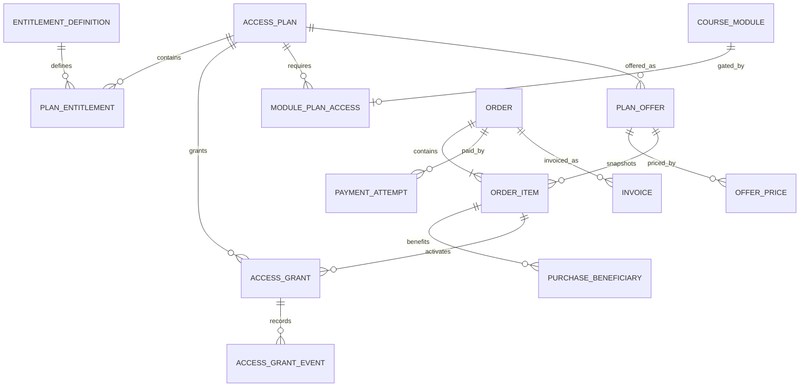

# Roadmap Implementasi Sunrise Digital Inklusif

Pembaruan: 27 Agustus 2026
Acuan: `Master_Prompt_Sunrise_Digital_Inklusif (3).md`

## Ringkasan produk

Sunrise Digital Inklusif adalah platform multi-sekolah untuk pembelajaran digital berbasis praktik. Sistem menyatukan LMS, praktik toko, konten affiliate, snapshot metrik historis, review dan revisi, monitoring per peran, early warning, reporting, serta tata kelola data anak.

## Asumsi teknis dan produk

- Implementasi yang sudah benar dipertahankan; perubahan baru dibuat secara incremental.
- `organization_id` adalah batas tenant utama dan `school_id` membatasi unit sekolah.
- Paket dan RBAC selalu dievaluasi terpisah. Paket tidak dapat melewati permission, tenant, consent, atau data governance.
- Paket canonical adalah `FREE`, `MEDIUM`, dan `ADVANCED`, dengan batas keras 8/10/12 modul terbit.
- Harga dan durasi berasal dari offer database. Nilai pada seed hanya data sintetis development/test.
- Aktivasi pembayaran production belum diaktifkan sampai provider, webhook, reconciliation, refund policy, dan legal terms selesai pada Fase 7.

## Arsitektur sistem

- `apps/web`: Next.js App Router untuk situs publik dan dashboard.
- `apps/api`: NestJS modular monolith dan REST API versioned.
- Worker BullMQ saat ini berjalan dari entry point terpisah di `apps/api`; pemisahan menjadi `apps/worker` dapat dilakukan tanpa mengubah domain job.
- PostgreSQL/Prisma menjadi source of truth, Redis untuk queue/rate limit/cache entitlement, dan S3/MinIO untuk file privat.
- Domain event/job selalu membawa tenant context. File dan export privat hanya tersedia melalui signed URL singkat setelah authorization.

## Struktur folder sasaran

```text
apps/
  web/
  api/
    src/access/       # plan resolver, entitlement, grant, cache
    src/auth/
    src/learning/
    src/infrastructure/
    src/<domain>/
prisma/
  schema.prisma
  migrations/
  seed.ts
docs/
deploy/
load/
scripts/
```

## ERD fondasi akses dan commerce



## Ringkasan role dan permission

| Role | Scope utama | Batas sensitif |
|---|---|---|
| Super Admin/Admin Pusat | Mandat organisasi/program | Tidak otomatis membuka tenant di luar mandat |
| Program Manager | Agregat program | Tidak otomatis membaca dokumen identitas |
| Admin Sekolah | Sekolah yang ditugaskan | Akses identitas/export perlu permission terpisah |
| Kepala Sekolah | Laporan sekolah | Perubahan nilai perlu permission khusus |
| Guru | Kelas/course yang ditugaskan | Tidak membaca NIK/KTP |
| Reviewer/Verifier | Queue yang dialokasikan | Review akademik dan identitas dipisah |
| Siswa | Data dan pekerjaan sendiri | Tidak melihat pembayaran wali/sekolah |
| Orang tua/wali | Anak dengan relasi aktif terverifikasi | Tidak melihat siswa lain atau credential |
| Support | Tiket yang dialokasikan | Tidak mendapat data sensitif secara default |

## Fase dan checklist

### Fase 1 — Fondasi

- [x] Next.js, NestJS, Prisma/PostgreSQL, Redis/BullMQ, dan object storage adapter.
- [x] Auth dasar, RBAC, tenant guard, audit, health, OpenAPI, Docker, dan CI.
- [x] Landing page, legal template, app shell, serta lead form berbasis backend.
- [x] Access plan dan katalog entitlement terpusat.
- [x] Resolver grant dengan prioritas user → class/program → school → organization → FREE.
- [x] Batas modul terbit 8/10/12 dan `minimum_plan`.
- [x] Cache entitlement tenant-aware dan invalidasi setelah grant berubah.
- [x] Fondasi offer, price snapshot, order, beneficiary, payment attempt, invoice, dan billing audit.
- [x] Halaman publik `/paket` membaca data API; keadaan tanpa data tidak menampilkan harga palsu.
- [x] Migration dan seed idempotent diverifikasi pada PostgreSQL lokal; verifikasi staging tetap bagian deployment.

### Fase 2 — Pengguna dan Master Data

- [x] Invitation, lifecycle user, siswa/guru/wali, tahun ajaran, kelas, enrollment, relasi wali, dan import async.
- [x] Search/filter/pagination serta test permission/cross-tenant dasar.
- [x] Hardening scope pengguna/mutasi, delegasi peran undangan, relasi wali lintas sekolah, dan staging NISN terenkripsi.
- [ ] Evaluasi entitlement pada seat/class/program grant setelah alokasi lisensi institusi diaktifkan.

### Fase 3 — Identitas dan Consent

- [x] Enkripsi identifier, blind index, private quarantine, verification, consent, dan data subject request.
- [x] Permission dokumen terpisah, consent identitas khusus, guardian effective scope, EXIF stripping, state transition, dan negative test.
- [ ] Bukti scanner malware production dan legal review retention/consent.

### Fase 4 — LMS dan Student Store

- [x] Course/module/lesson, progress, assignment, rubric, submission versioning, dan Student Store.
- [x] Pembatasan paket pada tree materi dan pembaruan progress modul.
- [x] Entitlement dan tenant guard pada assignment, rubric, submission, Student Store, file privat, serta jalur Affiliate yang membuka assignment.
- [x] Assignment berbasis modul, snapshot versi immutable, guarded review/revisi, draft grade tersembunyi, serta negative E2E Gratis/Advanced.
- [ ] Tambahkan private upload untuk generic submission/materi, reviewer allocation/moderation, prerequisite configurable, dan uji concurrency staging.

### Fase 5 — Affiliate

- [x] Account, content submission, review, snapshot historis, import, verification, dan data-quality flag.
- [ ] Terapkan entitlement Advanced ke seluruh endpoint, file, import, dan job affiliate.

### Fase 6 — Monitoring

- [x] Dashboard per peran, early warning, report/export async, dan statistik publik berpersetujuan.
- [ ] Terapkan variasi dashboard Gratis/Medium/Advanced dan entitlement export.

### Fase 7 — Pendukung dan Commerce

- [x] Notifikasi, announcement, certificate, achievement, portfolio, helpdesk, CMS, PWA, dan analytics consent.
- [x] Transfer bank manual per siswa, kode unik, masa berlaku, approval admin, audit, pencegahan self-approval, dan proteksi referensi transfer ganda.
- [x] Riwayat pesanan serta halaman Pembelian & Akses untuk pembeli dan approval admin.
- [ ] Checkout hosted/tokenized, webhook terverifikasi, payment event append-only, idempotent grant activation, dan reconciliation.
- [ ] Purchase request siswa ke wali/sekolah, institutional invoice, seat allocation, upgrade/renewal/refund/chargeback.
- [ ] Invoice privat, rekonsiliasi otomatis, refund, dan chargeback.

### Fase 8 — Hardening

- [x] Security/privacy/threat review, observability, backup/restore tooling, dan load-test harness.
- [ ] Test bypass entitlement end-to-end dan payment tampering/replay pada staging.
- [ ] Bukti browser/perangkat, ClamAV, alert delivery, storage lifecycle, dan restore staging.

## Risiko dan mitigasi

| Risiko | Mitigasi |
|---|---|
| Kebocoran lintas tenant | Tenant context dari session, query scoped, negative test, audit denial |
| Bypass paket melalui URL/API/file/job | Policy terpusat, server-side enforcement, signed URL setelah entitlement check, test lintas jalur |
| Cache akses stale setelah upgrade/revoke | TTL pendek, registry key per organisasi, invalidasi setelah mutasi grant |
| Webhook ganda atau palsu | Signature/timestamp verification, unique provider event, idempotent transaction, reconciliation |
| Pembayaran sukses tanpa akses | Outbox/retry, alert activation lag, exception queue, tidak meminta bayar ulang |
| Data anak atau pembayaran bocor | Minimalisasi, encryption, redaction, permission sensitif, storage privat, audit |
| Migration tidak teruji | Jalankan pada database disposable lalu staging, backup, migration check, rollback/runbook |

## Urutan lanjutan yang direkomendasikan

1. Aktifkan PostgreSQL lokal dan jalankan migration serta seed Fase 1 terbaru.
2. Tambahkan integration test resolver dari database dan cross-tenant grant mutation.
3. Selesaikan entitlement enforcement pada assignment, Student Store, affiliate, dashboard, export, file access, dan worker.
4. Bangun commerce workflow Fase 7 dengan adapter payment provider yang dipilih.
5. Jalankan hardening dan acceptance suite pada staging production-like.
